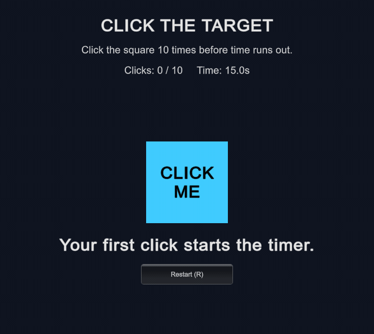

# GSD 390 — Click the Target

A simple Unity game: click the blue square 10 times within 15 seconds to win.
The first click starts the timer. If time runs out, you lose. Press **R** or click
**Restart** to play again.

## Open and play

1. Clone or download this repository.
2. Open the project in Unity **6000.0.62f1** through Unity Hub.
3. Choose **Tools > Play Click Target** (or open
   `Assets/ClickTarget/ClickTarget.unity` and press Play).

## Assignment requirements

- Win and lose conditions display **You Win!** and **You Lose!**.
- `Assets/ClickTarget/ClickTargetGame.cs` is the custom component: `Update()` reads
  mouse/keyboard input and updates the countdown using `Time.deltaTime`.
- `Assets/ClickTarget/Target.prefab` is saved as a prefab and instantiated in the scene.
- Restart is included as an optional extra.

## Demonstration

[Download the 30-second GIF](docs/ClickTarget-Win-and-Lose.gif).

The existing CoinRewardDemo scene is a separate earlier assignment.
